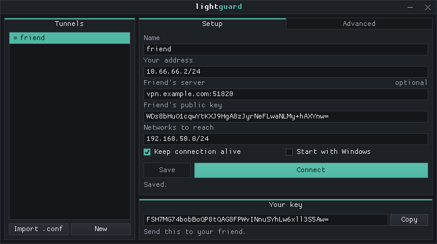

# lightguard

a tiny wireguard config tool in plain c. you open it to set up a tunnel, then close it. nothing stays running: the tunnels are normal os services (windows tunnel services, `wg-quick@name` on linux) and the tool only edits configs and starts/stops them.

## build

windows (visual studio build tools, x64):

    build.bat

gives a ~100 kb `lightguard.exe` with the ui font embedded, no runtime needed.

to find it in the start menu, run `install.ps1` in an admin shell (`uninstall.ps1` removes it, your configs stay).

linux (any c compiler):

    make

or `cc -Os -o lightguard src/lin.c src/lgcore.c`

both builds check the key code against the rfc 7748 vectors:

    lightguard --selftest

## use

windows: run `lightguard.exe` (asks for admin). tunnels are on the left: press new (a keypair is made for you) or import a `.conf` by button or by dropping it on the window. the setup panel on the right edits the selected tunnel: your address, your friend's server and public key, the networks to reach. send the key under "your key" to your friend. save, then connect. "start with windows" only sets the tunnel service to start at boot. the private key, a preshared key and delete are under advanced. connecting needs wireguard; if it is missing there is an install button (winget).

linux: run `sudo ./lightguard` (needs `wireguard-tools`). same layout in the terminal. tab switches between the tunnel list and the form, arrows move, enter connects (list) or edits a field (form), space toggles a checkbox. `n` new, `i` import, `s` save, `c` connect/disconnect, `y` copy the public key (terminal clipboard escape), `a` advanced (`v` show the private key, `g` new key, `p` preshared key), `d` delete, `q` quit. "start at boot" enables the `wg-quick@name` unit. the linux version is new and not tested much yet.

## privacy

configs are readable only by administrators (`%ProgramData%\lightguard`) or root (`/etc/wireguard`, mode 600), and nothing is sent anywhere.

## credits

curve25519 after tweetnacl (public domain). ui font proggyclean by tristan grimmer (mit license, see `assets/ProggyClean-LICENSE.txt`), as shipped with dear imgui. wireguard is a registered trademark of jason a. donenfeld.

## license

mit, see `LICENSE`.
